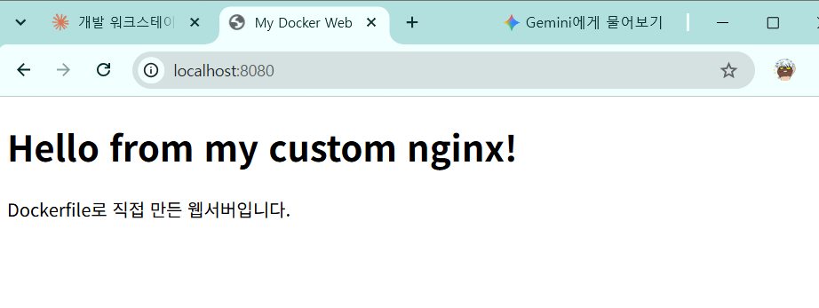
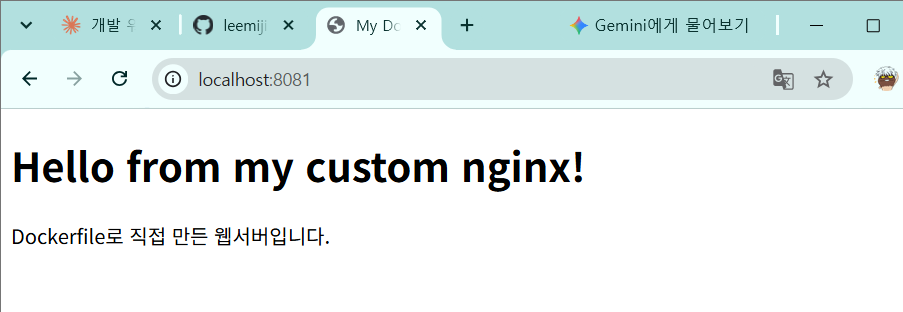
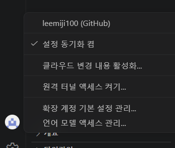
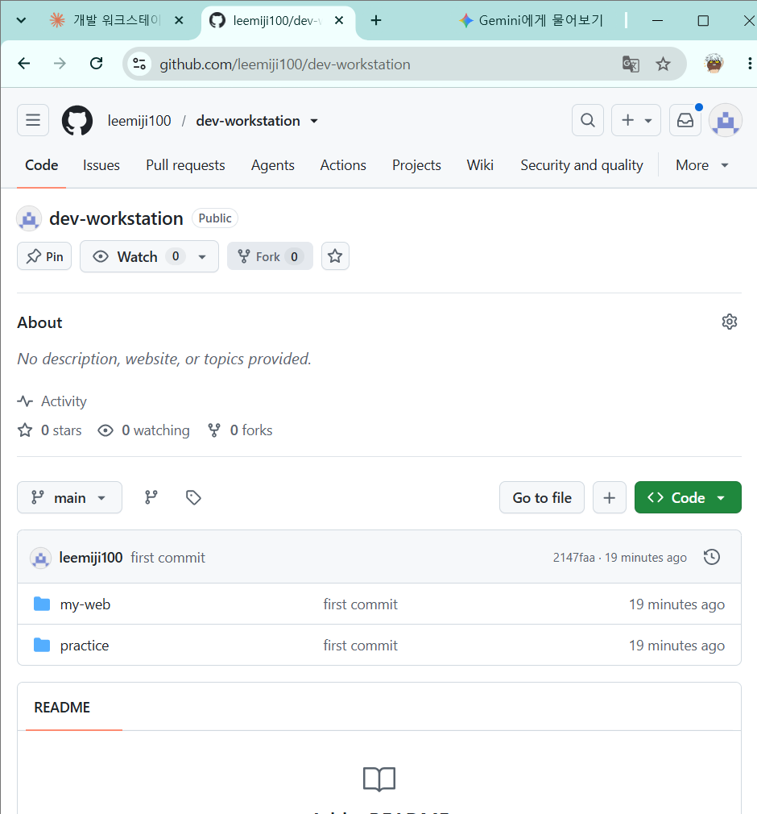

# 개발 워크스테이션 구축 (Terminal · Docker · Git)

## 1. 프로젝트 개요

터미널(CLI), Docker, Git/GitHub를 직접 세팅하고 사용해서 **누가 실행해도 같은 결과가 나오는 개발 환경**을 만드는 미션입니다.

- 터미널로 작업 폴더를 만들고 파일 권한을 바꿔 봅니다.
- Docker를 설치·점검하고 컨테이너를 실행·관리합니다.
- Dockerfile로 나만의 웹 서버 이미지를 만들고, 포트 매핑으로 브라우저에서 접속합니다.
- 바인드 마운트로 "변경 즉시 반영"을, 볼륨으로 "데이터 영속성"을 확인합니다.
- Git 설정 후 VSCode에서 GitHub에 로그인하고 저장소에 올립니다.

---

## 2. 실행 환경

| 항목 | 내용 |
|---|---|
| OS | Windows + WSL2 (Ubuntu) |
| 커널 | 6.18.54.1-microsoft-standard-WSL2 |
| Shell | bash |
| 터미널 | Windows Terminal (PowerShell 7.6.9 → `wsl`로 Ubuntu 진입), VSCode 통합 터미널 |
| Docker | Docker version 29.9.2, build a82e528 (Docker Desktop, WSL Integration 사용) |
| Git | git version 2.53.0 |
| 에디터 | VSCode + WSL 확장 (Microsoft) |

> **참고 (서울캠퍼스와 다른 점)**
> 과제 안내는 macOS + OrbStack 기준이지만, 이 환경은 **Windows PC**라서 OrbStack(맥 전용) 대신 **WSL2 + Docker Desktop**을 사용했습니다. 터미널에서 쓰는 `docker` 명령어는 똑같습니다.

---

## 3. 수행 체크리스트

- [x] 터미널 기본 조작 및 폴더 구성
- [x] 권한 변경 실습 (파일 1개, 디렉토리 1개)
- [x] Docker 설치 / 점검 (`docker --version`, `docker info`)
- [x] hello-world 실행
- [x] ubuntu 컨테이너 진입 + attach / exec 차이 관찰
- [x] Docker 운영 명령 (`images`, `ps`, `logs`, `stats`, `stop`)
- [x] Dockerfile 커스텀 이미지 빌드 / 실행
- [x] 포트 매핑 접속 (8080, 8081)
- [x] 바인드 마운트 반영 (8082)
- [x] 볼륨 영속성
- [x] Git 설정 + VSCode GitHub 연동
- [x] 트러블슈팅 3건

---

## 4. 저장소 구조

```
dev-workstation/
├── README.md            # 이 문서
├── docs/
│   └── images/          # 증거 스크린샷
│       ├── port-8080.png
│       ├── port-8081.png
│       ├── vscode-github.png
│       └── github-repo.png
├── my-web/              # Dockerfile 웹 서버
│   ├── Dockerfile
│   └── site/
│       └── index.html
└── practice/            # 터미널 / 권한 실습 파일
    ├── empty.txt
    ├── hello.txt
    └── run.sh
```

---

## 5. 검증 방법 요약

| 확인할 것 | 사용한 명령 | 결과 위치 |
|---|---|---|
| 터미널 조작 | `pwd`, `ls -la`, `mkdir`, `cp`, `mv`, `rm`, `cat`, `touch` | [6장](#6-터미널-조작-로그) |
| 권한 변경 | `ls -l`, `ls -ld`, `chmod` | [7장](#7-권한-실습) |
| Docker 설치 | `docker --version`, `docker info` | [8장](#8-docker-설치-및-점검) |
| 컨테이너 실행 | `docker run`, `exec`, `attach` | [9장](#9-컨테이너-실행-실습) |
| 운영 명령 | `docker images`, `ps -a`, `logs`, `stats` | [10장](#10-docker-운영-명령) |
| 커스텀 이미지 | `docker build` | [11장](#11-dockerfile-커스텀-이미지) |
| 포트 매핑 | `docker run -p`, `curl`, 브라우저 | [12장](#12-포트-매핑-및-접속-증거) |
| 바인드 마운트 | `docker run -v $(pwd)/site:...`, `sed`, `curl` | [13장](#13-바인드-마운트-반영) |
| 볼륨 영속성 | `docker volume create`, `docker rm -f` | [14장](#14-docker-볼륨-영속성) |
| Git / GitHub | `git config --list`, `git push` | [15장](#15-git-설정-및-github-연동) |

---

## 6. 터미널 조작 로그

현재 위치 확인, 목록 확인(숨김 파일 포함), 이동, 생성, 복사, 이름 변경, 삭제, 내용 확인, 빈 파일 생성을 수행했습니다.

```bash
$ pwd
/home/hp
$ mkdir -p ~/codyssey/workstation
$ cd ~/codyssey/workstation
$ ls -la
total 8
drwxr-xr-x 2 hp hp 4096 Oct 29 11:42 .
drwxr-xr-x 3 hp hp 4096 Oct 29 11:42 ..

$ mkdir practice
$ touch practice/empty.txt                       # 빈 파일 생성
$ echo "hello docker" > practice/hello.txt       # 내용 있는 파일 생성
$ cat practice/hello.txt                         # 내용 확인
hello docker

$ cp practice/hello.txt practice/hello_copy.txt          # 복사
$ mv practice/hello_copy.txt practice/renamed.txt        # 이름 변경
$ ls -la practice
total 16
drwxr-xr-x 2 hp hp 4096 Oct 29 11:43 .
drwxr-xr-x 3 hp hp 4096 Oct 29 11:42 ..
-rw-r--r-- 1 hp hp    0 Oct 29 11:42 empty.txt
-rw-r--r-- 1 hp hp   13 Oct 29 11:42 hello.txt
-rw-r--r-- 1 hp hp   13 Oct 29 11:43 renamed.txt

$ rm practice/renamed.txt                        # 삭제
$ ls -la practice
total 12
drwxr-xr-x 2 hp hp 4096 Oct 29 11:43 .
drwxr-xr-x 3 hp hp 4096 Oct 29 11:42 ..
-rw-r--r-- 1 hp hp    0 Oct 29 11:42 empty.txt
-rw-r--r-- 1 hp hp   13 Oct 29 11:42 hello.txt
```

### 절대 경로와 상대 경로

| 구분 | 뜻 | 예시 |
|---|---|---|
| 절대 경로 | 맨 위 `/`부터 시작하는 **전체 주소** | `/home/hp/codyssey/workstation/practice/hello.txt` |
| 상대 경로 | **지금 내 위치 기준**의 주소 | (`workstation`에 있을 때) `practice/hello.txt` |

- `~` 는 내 홈 폴더(`/home/hp`)의 줄임말입니다.
- `.` 은 지금 폴더, `..` 은 한 칸 위 폴더입니다. (`ls -la`에 숨김 항목으로 보임)

---

## 7. 권한 실습

### 권한 읽는 법

```
-rwxr-xr-x
│└┬┘└┬┘└┬┘
│ │  │  └─ 다른 사람 (others)
│ │  └──── 같은 그룹 (group)
│ └─────── 주인 (owner)
└───────── 종류: d = 디렉토리, - = 파일
```

| 글자 | 뜻 | 점수 |
|---|---|---|
| `r` | 읽기 (read) | 4 |
| `w` | 쓰기 (write) | 2 |
| `x` | 실행 (execute) | 1 |
| `-` | 권한 없음 | 0 |

세 묶음의 점수를 각각 더하면 숫자 표기가 됩니다.

- `rwx r-x r-x` → 7 5 5 → **755** (주인은 모두 가능, 나머지는 읽기+실행)
- `rw- r-- r--` → 6 4 4 → **644** (주인은 읽기+쓰기, 나머지는 읽기만)

### 실험 ① 파일 권한 변경 (644 → 755)

실행 권한이 없으면 스크립트가 실행되지 않는 것을 확인했습니다.

```bash
$ echo 'echo "script ok"' > practice/run.sh
$ ls -l practice/run.sh                     # 변경 전: 644
-rw-r--r-- 1 hp hp 17 Oct 29 11:46 practice/run.sh
$ ./practice/run.sh
-bash: ./practice/run.sh: Permission denied

$ chmod 755 practice/run.sh
$ ls -l practice/run.sh                     # 변경 후: 755
-rwxr-xr-x 1 hp hp 17 Oct 29 11:46 practice/run.sh
$ ./practice/run.sh
script ok
```

### 실험 ② 디렉토리 권한 변경 (755 → 700 → 755)

```bash
$ ls -ld practice                           # 변경 전: 755
drwxr-xr-x 2 hp hp 4096 Oct 29 11:46 practice
$ chmod 700 practice
$ ls -ld practice                           # 변경 후: 700 (주인만 접근)
drwx------ 2 hp hp 4096 Oct 29 11:46 practice
$ chmod 755 practice
$ ls -ld practice                           # 원래대로 복구
drwxr-xr-x 2 hp hp 4096 Oct 29 11:46 practice
```

---

## 8. Docker 설치 및 점검

### 설치 과정 (Windows)

```powershell
# PowerShell (관리자)
PS C:\Windows\System32> wsl --install
다운로드 중: Ubuntu
설치 중: Ubuntu
배포가 설치되었습니다. 'wsl.exe -d Ubuntu'을(를) 통해 시작할 수 있습니다.
Ubuntu 시작하는 중...
Provisioning the new WSL instance Ubuntu
Create a default Unix user account: hp
New password:                    # (입력 내용은 표시되지 않음)
Retype new password:
passwd: password updated successfully
```

이후 Docker Desktop for Windows를 설치하고 **Settings → Resources → WSL Integration → Ubuntu**를 켰습니다.

### 버전 확인

```bash
$ docker --version
Docker version 29.9.2, build a82e528
```

### 데몬 동작 확인 (`docker info` 발췌)

```bash
$ docker info
...
Server:
 ...
 Kernel Version: 6.18.54.1-microsoft-standard-WSL2
 Operating System: Docker Desktop
 OSType: linux
 Architecture: x86_64
 CPUs: 8
 Total Memory: 7.603GiB
 Name: docker-desktop
 Docker Root Dir: /var/lib/docker
 ...
```

`Server:` 아래에 엔진 정보가 나오면 데몬이 동작 중인 것입니다. (처음에는 권한 오류가 났습니다 → [트러블슈팅 #1](#트러블슈팅-1-dockersock-permission-denied))

---

## 9. 컨테이너 실행 실습

### hello-world

```bash
$ docker run hello-world
Unable to find image 'hello-world:latest' locally
latest: Pulling from library/hello-world
4f55086f7dd0: Pull complete
d5e71e642bf5: Download complete
Status: Downloaded newer image for hello-world:latest

Hello from Docker!
This message shows that your installation appears to be working correctly.
...
```

### 컨테이너 목록 (실행 중 vs 전체)

```bash
$ docker ps
CONTAINER ID   IMAGE     COMMAND   CREATED   STATUS    PORTS     NAMES

$ docker ps -a
CONTAINER ID   IMAGE         COMMAND    CREATED          STATUS                      PORTS     NAMES
c11745ff6992   hello-world   "/hello"   56 seconds ago   Exited (0) 55 seconds ago             distracted_edison
```

hello-world는 메시지를 출력하고 바로 종료되므로 `docker ps`에는 없고 `docker ps -a`에만 보입니다.

### ubuntu 컨테이너 진입

```bash
$ docker pull ubuntu
Using default tag: latest
latest: Pulling from library/ubuntu
Status: Downloaded newer image for ubuntu:latest
docker.io/library/ubuntu:latest

$ docker run -it --name my-ubuntu ubuntu bash
root@87915b19b552:/# ls
bin   dev  home  lib64  mnt  proc  run   srv  tmp  var
boot  etc  lib   media  opt  root  sbin  sys  usr
root@87915b19b552:/# echo "hello from container"
hello from container
root@87915b19b552:/# exit
```

컨테이너 안 `ls`에는 호스트에서 만든 `practice` 폴더가 보이지 않습니다. 컨테이너는 **격리된 실행 환경**이기 때문입니다.

### attach와 exec의 차이 관찰

```bash
$ docker ps -a
87915b19b552   ubuntu   "bash"   29 seconds ago   Exited (0) 21 seconds ago   my-ubuntu

$ docker start my-ubuntu
my-ubuntu
$ docker ps
87915b19b552   ubuntu   "bash"   51 seconds ago   Up 3 seconds   my-ubuntu

# exec: 새 bash로 들어갔다 나옴
$ docker exec -it my-ubuntu bash
root@87915b19b552:/# exit
$ docker ps
87915b19b552   ubuntu   "bash"   About a minute ago   Up 39 seconds   my-ubuntu     # 계속 켜져 있음

# attach: 메인 bash에 연결했다 나옴
$ docker attach my-ubuntu
root@87915b19b552:/# exit
$ docker ps -a
87915b19b552   ubuntu   "bash"   About a minute ago   Exited (0) 3 seconds ago   my-ubuntu   # 꺼짐
```

| 방식 | 들어가는 곳 | `exit` 후 컨테이너 |
|---|---|---|
| `exec` | **새 프로세스**(bash)를 하나 더 실행 | 계속 실행 (Up) |
| `attach` | 컨테이너의 **메인 프로세스**에 연결 | 종료 (Exited) |

**정리:** 컨테이너는 메인 프로세스(여기서는 `bash`)가 살아 있는 동안만 실행됩니다. `exec`는 손님용 bash만 종료되므로 컨테이너가 유지되고, `attach`에서 `exit`하면 메인 bash가 끝나서 컨테이너도 멈춥니다. 실행 중인 서비스를 살펴볼 때는 `exec`가 안전합니다. (`attach` 상태에서 끄지 않고 나오려면 `Ctrl+P` → `Ctrl+Q`)

---

## 10. Docker 운영 명령

### 이미지 목록

```bash
$ docker images
IMAGE                ID             DISK USAGE   CONTENT SIZE   EXTRA
hello-world:latest   c567b231f656       25.9kB         9.49kB    U
ubuntu:latest        0e73b71479e7        163MB         45.9MB
```

### 백그라운드 실행 + 로그 + 리소스 + 중지

```bash
$ docker run -d --name nginx-test nginx
Unable to find image 'nginx:latest' locally
...
Status: Downloaded newer image for nginx:latest
73d4d19d293d730406b3f5a80c729bd801d6666b2cad1d6c0b2eafa1f027748a

$ docker ps
CONTAINER ID   IMAGE     COMMAND                  CREATED         STATUS         PORTS     NAMES
73d4d19d293d   nginx     "/docker-entrypoint.…"   6 seconds ago   Up 5 seconds   80/tcp    nginx-test

$ docker logs nginx-test
/docker-entrypoint.sh: Configuration complete; ready for start up
2026/10/29 02:53:34 [notice] 1#1: nginx/1.31.8
2026/10/29 02:53:34 [notice] 1#1: OS: Linux 6.18.54.1-microsoft-standard-WSL2
2026/10/29 02:53:34 [notice] 1#1: start worker processes
2026/10/29 02:53:34 [notice] 1#1: start worker process 29
...
2026/10/29 02:53:34 [notice] 1#1: start worker process 36

$ docker stats --no-stream
CONTAINER ID   NAME         CPU %     MEM USAGE / LIMIT    MEM %     NET I/O         BLOCK I/O     PIDS
73d4d19d293d   nginx-test   0.00%     7.52MiB / 7.603GiB   0.10%     1.17kB / 126B   0B / 12.3kB   9

$ docker stop nginx-test
nginx-test
$ docker ps -a
CONTAINER ID   IMAGE         COMMAND                  CREATED         STATUS                     PORTS     NAMES
73d4d19d293d   nginx         "/docker-entrypoint.…"   4 minutes ago   Exited (0) 3 seconds ago             nginx-test
87915b19b552   ubuntu        "bash"                   7 minutes ago   Exited (0) 5 minutes ago             my-ubuntu
c11745ff6992   hello-world   "/hello"                 9 minutes ago   Exited (0) 9 minutes ago             distracted_edison
```

**관찰한 점**
- nginx 워커가 8개 뜬 것은 `docker info`의 `CPUs: 8`에 맞춰 자동 조정되었기 때문입니다.
- `PIDS 9` = 마스터 프로세스 1개 + 워커 8개
- 로그 시간(02:53)은 UTC 기준이라 한국 시간(11:53)과 9시간 차이가 납니다.
- 이 상태의 `PORTS 80/tcp`는 컨테이너 안쪽 포트만 열린 것이라 호스트에서 접속할 수 없습니다. (→ 12장 포트 매핑)

---

## 11. Dockerfile 커스텀 이미지

### 선택한 방식

**(A) 웹 서버 베이스 이미지 활용** — 공식 `nginx:alpine` 이미지 위에 내 정적 웹페이지와 설정을 추가했습니다.

### 소스 코드

`my-web/site/index.html`

```html
<!DOCTYPE html>
<html>
<head>
  <meta charset="UTF-8">
  <title>My Docker Web</title>
</head>
<body>
  <h1>Hello from my custom nginx!</h1>
  <p>Dockerfile로 직접 만든 웹서버입니다.</p>
</body>
</html>
```

`my-web/Dockerfile`

```dockerfile
# 1. 기존 nginx 틀을 가져온다 (가벼운 alpine 버전)
FROM nginx:alpine

# 2. 이 틀에 이름표를 붙인다
LABEL org.opencontainers.image.title="my-custom-web"

# 3. 환경 변수를 넣는다 (지금은 개발 모드)
ENV APP_ENV=dev

# 4. 내 웹페이지를 nginx가 보여주는 폴더에 복사한다
COPY site/ /usr/share/nginx/html/

# 5. 이 컨테이너는 80번 문을 쓴다고 알려준다
EXPOSE 80

# 6. 30초마다 웹서버가 살아 있는지 스스로 검사한다
HEALTHCHECK --interval=30s --timeout=3s \
  CMD wget -qO- http://localhost/ || exit 1
```

### 커스텀 포인트와 목적

| 커스텀 포인트 | 목적 |
|---|---|
| `FROM nginx:alpine` | 웹 서버를 처음부터 만들지 않고 검증된 공식 이미지를 재사용. alpine으로 이미지 크기 축소 (nginx:latest 243MB → my-web 93.6MB) |
| `LABEL` | 이미지가 무엇인지 메타데이터로 표시 |
| `ENV APP_ENV=dev` | 실행 모드 같은 설정을 코드와 분리 |
| `COPY site/ ...` | nginx 기본 페이지 대신 내 웹페이지 제공 |
| `EXPOSE 80` | 컨테이너가 사용하는 포트를 문서화 |
| `HEALTHCHECK` | 서버가 실제로 응답하는지 Docker가 주기적으로 확인 (`healthy` 표시) |

### 빌드

```bash
$ cd ~/codyssey/workstation/my-web
$ docker build -t my-web:1.0 .
[+] Building 9.9s (8/8) FINISHED                             docker:default
 => [internal] load build definition from Dockerfile                   0.1s
 => [internal] load metadata for docker.io/library/nginx:alpine        3.8s
 => [internal] load .dockerignore                                      0.1s
 => [internal] load build context                                      0.1s
 => [1/2] FROM docker.io/library/nginx:alpine@sha256:785835ea65db4bba  3.9s
 => [2/2] COPY site/ /usr/share/nginx/html/                            0.1s
 => exporting to image                                                 1.7s
 => => naming to docker.io/library/my-web:1.0                          0.0s

$ docker images
IMAGE                ID             DISK USAGE   CONTENT SIZE   EXTRA
hello-world:latest   c567b231f656       25.9kB         9.49kB    U
my-web:1.0           163ab69c3d10       93.6MB         26.3MB
nginx:latest         600f7cd45e27        243MB         66.8MB    U
ubuntu:latest        0e73b71479e7        163MB         45.9MB    U
```

`FROM`과 `COPY`만 빌드 단계(레이어)로 나타나고, `LABEL`·`ENV`·`EXPOSE`·`HEALTHCHECK`는 이미지 설정 정보로 저장됩니다.

---

## 12. 포트 매핑 및 접속 증거

### 포트 매핑이 필요한 이유

컨테이너는 격리된 네트워크 안에서 실행되기 때문에, 컨테이너 안의 80번 포트는 호스트(내 PC)에서 바로 접속할 수 없습니다. `-p <호스트포트>:<컨테이너포트>`로 **호스트의 포트를 컨테이너 포트에 연결**해야 브라우저로 접속할 수 있습니다. 또한 같은 이미지로 여러 컨테이너를 띄울 때 안쪽 포트(80)는 같아도 **바깥 포트를 다르게** 주면 충돌 없이 동시에 실행할 수 있습니다.

### 8080 → 80

```bash
$ docker run -d -p 8080:80 --name my-web-8080 my-web:1.0
e93a5b275e483907cb64fb5db83ba07053d71fc1f3441e5846ad06f7c45ad407

$ docker ps
CONTAINER ID   IMAGE        COMMAND                  CREATED          STATUS                    PORTS                                     NAMES
e93a5b275e48   my-web:1.0   "/docker-entrypoint.…"   44 seconds ago   Up 43 seconds (healthy)   0.0.0.0:8080->80/tcp, [::]:8080->80/tcp   my-web-8080
```



### 8081 → 80 (같은 이미지로 두 번째 컨테이너)

```bash
$ docker run -d -p 8081:80 --name my-web-8081 my-web:1.0
fda6781781762c8da25548fb0efc3ab158d85f2669147bc2d11a65bbdc917dd8

$ docker ps
CONTAINER ID   IMAGE        COMMAND                  CREATED         STATUS                            PORTS                                     NAMES
fda678178176   my-web:1.0   "/docker-entrypoint.…"   3 seconds ago   Up 3 seconds (health: starting)   0.0.0.0:8081->80/tcp, [::]:8081->80/tcp   my-web-8081
e93a5b275e48   my-web:1.0   "/docker-entrypoint.…"   2 minutes ago   Up 2 minutes (healthy)            0.0.0.0:8080->80/tcp, [::]:8080->80/tcp   my-web-8080
```



### curl 응답 (두 포트 모두)

```bash
$ curl http://localhost:8080
<!DOCTYPE html>
<html>
<head>
  <meta charset="UTF-8">
  <title>My Docker Web</title>
</head>
<body>
  <h1>Hello from my custom nginx!</h1>
  <p>Dockerfile로 직접 만든 웹서버입니다.</p>
</body>
</html>

$ curl http://localhost:8081
(위와 동일한 응답)
```

---

## 13. 바인드 마운트 반영

호스트의 `my-web/site` 폴더를 컨테이너의 nginx 웹 폴더에 **직접 연결**했습니다.

```bash
$ docker run -d -p 8082:80 --name my-web-bind \
    -v $(pwd)/site:/usr/share/nginx/html my-web:1.0
94e272128a354353cd99559f796173ceade7bd4b14b3cf9e519152b7094a9387
```

`$(pwd)`는 현재 위치의 **절대 경로**로 바뀝니다. 바인드 마운트는 호스트 경로를 절대 경로로 지정해야 합니다.

### 변경 전

```bash
$ curl http://localhost:8082
...
  <h1>Hello from my custom nginx!</h1>
...
```

### 호스트에서 파일 수정 (컨테이너는 건드리지 않음)

```bash
$ sed -i 's/Hello from my custom nginx!/Bind mount works! Changed on host!/' site/index.html
$ cat site/index.html
...
  <h1>Bind mount works! Changed on host!</h1>
...
```

### 변경 후 비교

```bash
$ curl http://localhost:8082        # 바인드 마운트 컨테이너
...
  <h1>Bind mount works! Changed on host!</h1>     ← 즉시 반영됨
...

$ curl http://localhost:8080        # COPY로 이미지에 넣은 컨테이너
...
  <h1>Hello from my custom nginx!</h1>            ← 그대로
...
```

| 컨테이너 | 웹페이지를 넣은 방식 | 호스트 파일 수정 후 |
|---|---|---|
| my-web-bind (8082) | 바인드 마운트 (호스트 폴더 연결) | **즉시 반영** |
| my-web-8080 (8080) | 빌드 시 `COPY` (이미지에 복사) | 변화 없음 (다시 빌드해야 반영) |

> 이 실험 때문에 저장소의 `my-web/site/index.html`은 현재 `Bind mount works! Changed on host!` 문구로 되어 있습니다. 그대로 빌드하면 이 문구가 나옵니다.

---

## 14. Docker 볼륨 영속성

### Docker 볼륨이란?

Docker가 직접 관리하는 저장 공간입니다. 컨테이너 안의 데이터는 컨테이너를 삭제하면 함께 사라지지만, **볼륨에 저장한 데이터는 컨테이너와 따로 존재**하므로 컨테이너를 지워도 남아 있습니다. 데이터베이스처럼 지켜야 하는 데이터에 사용합니다.

| 구분 | 바인드 마운트 | 볼륨 |
|---|---|---|
| 저장 위치 | 내가 지정한 호스트 폴더 | Docker가 관리하는 공간 |
| 지정 방법 | `-v /절대경로:/컨테이너경로` | `-v 볼륨이름:/컨테이너경로` |
| 주 용도 | 개발 중 코드 즉시 반영 | 데이터 영속 보관 |

### 생성 → 연결 → 데이터 저장

```bash
$ docker volume create my-data
my-data
$ docker volume ls
DRIVER    VOLUME NAME
local     my-data

$ docker run -d --name vol-test1 -v my-data:/data ubuntu sleep infinity
7cf300c39a3af4632f54898334c571133819b8ca13119ada4c7fe756e9f130b4

$ docker exec vol-test1 bash -c "echo 'my precious data' > /data/note.txt && cat /data/note.txt"
my precious data
```

### 컨테이너 삭제

```bash
$ docker rm -f vol-test1
vol-test1

$ docker ps -a          # vol-test1 사라짐
CONTAINER ID   IMAGE         ...   NAMES
94e272128a35   my-web:1.0    ...   my-web-bind
fda678178176   my-web:1.0    ...   my-web-8081
e93a5b275e48   my-web:1.0    ...   my-web-8080
73d4d19d293d   nginx         ...   nginx-test
87915b19b552   ubuntu        ...   my-ubuntu
c11745ff6992   hello-world   ...   distracted_edison

$ docker volume ls      # 볼륨은 남아 있음
DRIVER    VOLUME NAME
local     my-data
```

### 새 컨테이너에서 확인

```bash
$ docker run -d --name vol-test2 -v my-data:/data ubuntu sleep infinity
22e98525e5506a102d16266d2411aebef40e9e4cfb7d00ac173b6109050d7154

$ docker exec vol-test2 cat /data/note.txt
my precious data
```

`vol-test2`는 파일을 만든 적이 없지만 데이터가 그대로 남아 있습니다. → **컨테이너가 삭제되어도 볼륨 데이터는 유지됨을 확인**

---

## 15. Git 설정 및 GitHub 연동

### Git과 GitHub의 차이

| 구분 | Git | GitHub |
|---|---|---|
| 정체 | 내 컴퓨터에서 동작하는 **버전 관리 도구** | Git 저장소를 올려두는 **원격 협업 플랫폼** |
| 하는 일 | 변경 이력 저장(commit), 되돌리기, 브랜치 | 저장소 공유, 협업, 코드 리뷰, 백업 |
| 비유 | 게임의 세이브 기능 | 세이브 파일을 올려두는 클라우드 |

### Git 사용자 정보 / 기본 브랜치 설정

```bash
$ git --version
git version 2.53.0
$ git config --global user.name "leemiji100"
$ git config --global user.email "dl********@naver.com"     # 마스킹
$ git config --global init.defaultBranch main

$ git config --list
user.name=leemiji100
user.email=dl********@naver.com          # 마스킹
init.defaultbranch=main
```

### VSCode GitHub 로그인

VSCode (WSL: Ubuntu 원격) 왼쪽 아래 계정 메뉴에서 GitHub 로그인 완료



### 저장소 연동 및 push

```bash
$ git remote set-url origin https://github.com/leemiji100/dev-workstation.git
$ git remote -v
origin  https://github.com/leemiji100/dev-workstation.git (fetch)
origin  https://github.com/leemiji100/dev-workstation.git (push)

$ git push -u origin main
Total 10 (delta 0), reused 0 (delta 0), pack-reused 0 (from 0)
To https://github.com/leemiji100/dev-workstation.git
 * [new branch]      main -> main
```



---

## 16. 트러블슈팅

### 트러블슈팅 #1: docker.sock permission denied

| 단계 | 내용 |
|---|---|
| **문제** | `docker info` 실행 시 `Server:` 부분에서 오류 발생 |
| **원인 가설** | 현재 사용자(`hp`)가 Docker 소켓에 접근할 권한이 없다 (docker 그룹 미가입) |
| **확인** | `ls -l /var/run/docker.sock` 으로 소켓 권한 확인, `groups` 로 소속 그룹 확인 → `docker` 그룹 없음 |
| **해결** | 사용자를 docker 그룹에 추가 후 WSL 재시작 |

```bash
$ docker info
...
Server:
permission denied while trying to connect to the docker API at unix:///var/run/docker.sock

# 해결
$ sudo groupadd docker
$ sudo usermod -aG docker $USER
$ exit
PS> wsl --shutdown          # PowerShell에서 WSL 재시작
# Ubuntu 다시 열기

$ groups                    # docker 그룹 포함 확인
$ docker info               # Server 정보 정상 출력
```

**배운 점:** 권한(r/w/x)은 파일뿐 아니라 Docker 엔진과 통신하는 소켓에도 적용됩니다. 그룹 변경은 다시 로그인해야 적용됩니다.

### 트러블슈팅 #2: GitHub 저장소 404 (이름 중복 입력 + 비공개)

| 단계 | 내용 |
|---|---|
| **문제** | VSCode에서 GitHub에 게시한 뒤 저장소 주소로 접속하면 404 |
| **원인 가설** | ① 주소 오타 ② 저장소가 Private이라 비로그인 상태에서 안 보임 |
| **확인** | `git remote -v` → 저장소 이름이 `dev-workstationdev-workstation`으로 **중복 입력**되어 생성됨. 저장소 목록에서 해당 저장소가 **Private**이고, 웹에서 미리 만든 빈 Public 저장소 `dev-workstation`이 따로 있음을 확인 |
| **해결** | 빈 Public 저장소 `dev-workstation`으로 원격 주소를 바꾸고 push |

```bash
$ git remote -v
origin  https://github.com/leemiji100/dev-workstationdev-workstation.git (fetch)
origin  https://github.com/leemiji100/dev-workstationdev-workstation.git (push)

# 해결
$ git remote set-url origin https://github.com/leemiji100/dev-workstation.git
$ git push -u origin main
 * [new branch]      main -> main
```

**배운 점:** VSCode 입력창에 기본값이 미리 채워져 있으면 지우고 입력해야 합니다. GitHub에서 이름을 바꿀 때 앞에 공백이 있으면 `-`로 자동 변환된다는 것도 확인했습니다. `git remote -v`로 실제 연결 주소를 먼저 확인하는 것이 가장 빠른 진단 방법이었습니다.

### 트러블슈팅 #3: WSL 시작 위치가 Windows 시스템 폴더

| 단계 | 내용 |
|---|---|
| **문제** | WSL 설치 직후 프롬프트가 `/mnt/c/Windows/System32` |
| **원인 가설** | 관리자 PowerShell의 현재 위치(`C:\Windows\System32`)에서 Ubuntu를 시작했기 때문 |
| **확인** | `pwd` 로 위치 확인 → `/mnt/c/...` 는 Windows C 드라이브를 연결한 경로 |
| **해결** | `cd ~` 로 리눅스 홈(`/home/hp`)으로 이동 후 작업. 이후에는 시작 메뉴에서 Ubuntu를 직접 실행 |

**배운 점:** Windows 시스템 폴더에서 작업하면 위험하고, Windows 드라이브(`/mnt/c`) 위의 파일은 WSL에서 느리므로 리눅스 홈에서 작업해야 합니다.

---

## 17. 재현 방법 (평가자용)

Windows라면 WSL2 + Docker Desktop(WSL Integration 켜기), macOS라면 OrbStack 또는 Docker Desktop을 준비한 뒤 아래를 따라 하면 같은 결과를 확인할 수 있습니다.

```bash
# 1. 저장소 받기
git clone https://github.com/leemiji100/dev-workstation.git
cd dev-workstation/my-web

# 2. 이미지 빌드
docker build -t my-web:1.0 .

# 3. 포트 매핑 실행 및 확인
docker run -d -p 8080:80 --name my-web-8080 my-web:1.0
curl http://localhost:8080          # 또는 브라우저에서 http://localhost:8080
docker ps                           # 30초 후 (healthy) 확인

# 4. 바인드 마운트 확인
docker run -d -p 8082:80 --name my-web-bind -v $(pwd)/site:/usr/share/nginx/html my-web:1.0
# site/index.html 을 수정한 뒤
curl http://localhost:8082          # 수정 내용이 바로 반영됨

# 5. 볼륨 영속성 확인
docker volume create my-data
docker run -d --name vol-test1 -v my-data:/data ubuntu sleep infinity
docker exec vol-test1 bash -c "echo 'my precious data' > /data/note.txt"
docker rm -f vol-test1
docker run -d --name vol-test2 -v my-data:/data ubuntu sleep infinity
docker exec vol-test2 cat /data/note.txt     # my precious data

# 6. 정리
docker rm -f my-web-8080 my-web-bind vol-test2
docker volume rm my-data
```

**주의사항**
- 8080/8081/8082 포트를 다른 프로그램이 쓰고 있으면 `-p 9090:80`처럼 바깥 포트를 바꿔서 실행하세요.
- 같은 이름의 컨테이너가 이미 있으면 `docker rm -f <이름>`으로 지운 뒤 다시 실행하세요.
- Linux에서 `permission denied` 가 나오면 [트러블슈팅 #1](#트러블슈팅-1-dockersock-permission-denied)을 참고하세요.

---

## 18. 보안 및 개인정보

- Git 이메일은 `dl********@naver.com` 형태로 마스킹했습니다.
- WSL 비밀번호, GitHub 토큰 등 인증 정보는 문서와 스크린샷에 포함하지 않았습니다.
- GitHub 인증은 VSCode의 GitHub 로그인(브라우저 승인 방식)을 사용해 토큰을 직접 다루지 않았습니다.
